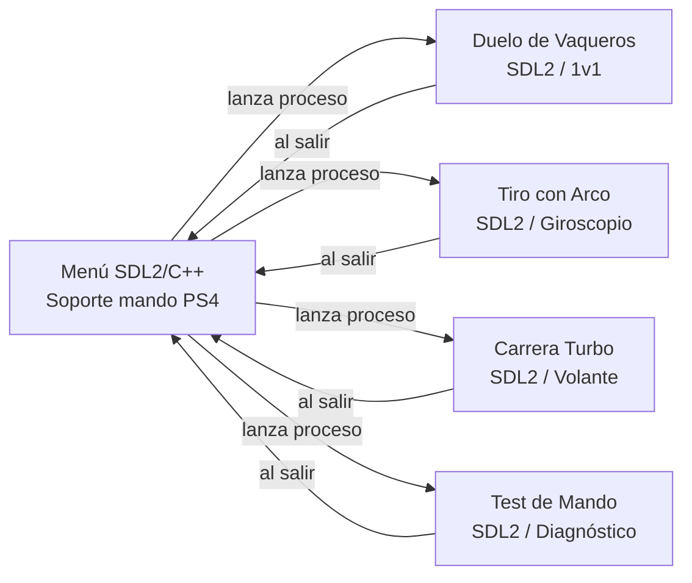

# Mini Juegos — Menú Arcade con Mandos DualShock 4

Proyecto en equipo (2 personas) para la exposición: un lanzador/menú estilo arcade que lista y ejecuta minijuegos independientes interactivos diseñados especialmente para mandos **PlayStation 4 (DualShock 4)** con soporte de sensores de movimiento, vibración háptica y barra de luz LED.

Cada juego es un **ejecutable independiente** (C++/SDL2 o build de Unity) que el menú lanza como proceso hijo. Al salir del juego, se regresa automáticamente al menú principal.

---

## Arquitectura



- **Menú** (`menu/`): Desarrollado en SDL2 + SDL2_ttf. Lee dinámicamente `games.registry`, presenta una interfaz animada y lanza los juegos. Compatible con mando y teclado.
- **Juegos SDL2** (`games/sdl2/`): Cada minijuego es un proyecto C++17 independiente con su propio bucle de juego, físicas y renderizado.
- **Juegos Unity** (`games/unity/`): Proyectos Unity que se exportan como binarios a `build/bin/` y se registran en el menú.

---

## Estructura del Repositorio

```text
.
├── CMakeLists.txt              # Configuración raíz de compilación (CMake)
├── games.registry              # Registro de juegos (formato TSV: id, nombre, desc, rutas)
├── cmake/
│   └── SetupSDL2Windows.cmake  # Descarga y despliegue automático de SDL2 en Windows
├── menu/                       # Menú principal (SDL2/C++)
│   └── src/
├── games/
│   ├── sdl2/                   # Juegos nativos en C++ / SDL2
│   │   ├── duelo_vaqueros/     # Duelo Western 1v1 con reflejos y bullet-time
│   │   ├── tiro_con_arco/      # Tiro al blanco de feria con apuntado por giroscopio
│   │   ├── carrera_turbo/      # Conducción en 1ª persona con volante DualShock
│   │   ├── test_mando/         # Herramienta de diagnóstico de ejes, giroscopio y vibración
│   │   └── template_game/      # Plantilla base para añadir nuevos juegos
│   └── unity/                  # Espacio para proyectos Unity exportados
├── scripts/
│   ├── build.sh                # Compilación rápida en Linux
│   └── build.bat               # Compilación automatizada en Windows
└── docs/
    └── WORKFLOW.md             # Guía de trabajo colaborativo en Git
```

---

## Requisitos y Compatibilidad

El proyecto es **100% multiplataforma** y compila de forma nativa tanto en **Linux** como en **Windows**.

### Requisitos Generales
- **CMake ≥ 3.16**
- **Compilador C++17** (GCC / Clang en Linux, MSVC o MinGW en Windows)

### Linux (Debian / Ubuntu / derivados)
Instala las herramientas de compilación y las librerías de desarrollo de SDL2:
```bash
sudo apt update
sudo apt install cmake g++ libsdl2-dev libsdl2-ttf-dev libsdl2-mixer-dev
```

### Windows (10 / 11)
**¡Instalación sin complicaciones!** No necesitas descargar ni configurar librerías manualmente en Windows. El sistema de CMake descarga automáticamente los paquetes oficiales de SDL2, SDL2_ttf y SDL2_mixer en su primera ejecución y copia todas las `.dll` necesarias a la carpeta `build/bin/`.

Solo necesitas tener instalado:
1. [CMake para Windows](https://cmake.org/download/) (asegúrate de marcar *"Add CMake to system PATH"* durante la instalación).
2. Compilador de C++:
   - **Visual Studio 2019 / 2022** con la carga de trabajo *"Desarrollo para el escritorio con C++"*, o
   - **MinGW-w64** (GCC).

---

## Compilación y Ejecución

### En Linux:
```bash
# Compilar todo el proyecto (menú + juegos)
./scripts/build.sh

# Ejecutar el menú
./build/bin/menu
```

### En Windows:
Simplemente haz **doble clic** sobre el archivo:
```bat
scripts\build.bat
```
O compila desde la consola (CMD o PowerShell):
```bat
scripts\build.bat
build\bin\menu.exe
```

> **Nota:** Puedes ejecutar `menu` desde la raíz o directamente haciendo doble clic sobre el ejecutable en `build/bin/`. El lanzador detecta automáticamente el directorio de trabajo y localiza `games.registry` y los recursos.

---

## Juegos Incluidos y Controles

### 1. Tiro al Blanco (Puesto de Feria con Apuntado Físico)
Juego de puntería en primera persona ambientado en un puesto de feria neobrutalista. El jugador apunta con la orientación del DualShock y dispara a una fila de latas metálicas.

* **Apuntado por sensores**: El giroscopio mueve la mira; el ratón sirve como alternativa. La mira se puede recentrar durante la partida.
* **Disparo instantáneo**: Cada pulsación de R2 o clic izquierdo dispara una vez; no hace falta cargar ni soltar el gatillo.
* **Cinco blancos derribables**: Latas grandes, separadas y numeradas. Sus formaciones, alturas, diseños y colores varían en cada ronda; cada acierto las hace caer.
* **10 puestos**: Cinco disparos por puesto para derribar cinco latas; completar el puesto sin fallar otorga un bonus de 100 puntos.
* **Pistola en primera persona**: Modelo low-poly con volumen, caras sombreadas, manos y detalles neobrutalistas; gira en horizontal y vertical con la mira y revela sus laterales al apuntar hacia los costados.
* **Mira y arma sincronizadas**: La pistola acompaña el apuntado horizontal y verticalmente, y la mira vuelve al centro al cerrar cada ronda. La calibración toma como centro la postura cómoda actual del jugador.
* **Reinicio accesible**: El menú de pausa permite volver a la ronda 1 y reiniciar la puntuación de la partida.
* **Estética de feria neobrutalista**: Marquesina a rayas, bombillas, panel trasero dividido en cinco carriles, mostrador y piso a cuadros con contornos negros y sombras marcadas.
* **Récord Persistente**: Guarda la puntuación máxima en disco y avisa al superar el récord.

| Acción | Mando DualShock 4 | Teclado / Ratón |
|---|---|---|
| **Apuntar** | Orientación física del mando | Movimiento del ratón |
| **Disparar** | Pulsar **Gatillo R2** | Clic izquierdo |
| **Recalibrar / Centrar** | Botón **Triángulo [△]** o **L1** | Tecla **[C]** o **[R]** |
| **Ajuste Auxiliar** | **Stick Derecho** | — |
| **Menú de Pausa / Configuración** | Botón **Options / Start** | Tecla **[ESC]** |

---

### 2. Duelo de Vaqueros
Duelo rápido de reflejos estilo Western para 2 jugadores con mandos PS4 o contra la máquina.
* Barra de luz LED y sonido de tensión creciente.
* Detección de desenfunde, disparo en el momento exacto de la señal, efecto Hit-Stop y cámara lenta (Bullet-Time) con estelas de proyectil.

| Acción | Jugador 1 (Mando) | Jugador 2 / Teclado |
|---|---|---|
| **Disparar / Desfundar** | Gatillo **R2** o botón **X** | Tecla **Espacio** o **Enter** |
| **Reiniciar Ronda** | Botón **X** | Tecla **Espacio** |
| **Salir al Menú** | Botón **Círculo [O]** | Tecla **ESC** |

---

### 3. Test de Mando
Herramienta de diagnóstico visual para verificar el estado de los controles antes de jugar.
* Lectura en tiempo real de todos los ejes analógicos (palancas y gatillos progresivos L2/R2).
* Telemetría de sensores de movimiento: valores crudos de **Giroscopio (X, Y, Z)** y **Acelerómetro (X, Y, Z)**.
* Prueba de motores de vibración háptica (Rumble bajo y alto) y verificación de conectividad HIDAPI.

| Acción | Mando DualShock 4 | Teclado |
|---|---|---|
| **Probar Vibración** | Botón **Triángulo [△]** | Tecla **Espacio** |
| **Salir al Menú** | Botón **Círculo [O]** | Tecla **ESC** |

---

### 4. Carrera Turbo (Conducción Neobrutalista en Primera Persona)
Juego de carreras arcade en primera persona con tecnología pseudo-3D rasterizada por segmentos estilo *OutRun*, con estética visual **Neobrutalista** idéntica a *Duelo de Vaqueros* (bloques de color saturados, bordes negros gruesos y sombras duras sin degradado).

* **Volante Físico por Giroscopio**: Sostén el DualShock 4 con ambas manos frente a ti e inclínalo hacia los lados para girar como un volante de carreras real (estilo *Gran Turismo* con Sixaxis).
* **Cabina en Primera Persona con Volante Animado**: En la parte inferior se renderiza el volante deportivo con franja de centrado que gira en tiempo real exactamente según la inclinación física del mando.
* **Aceleración y Frenado Progresivo**: Gatillos analógicos **R2** (acelerador) y **L2** (freno / reversa).
* **Física Arcade con Curvas y Desniveles**: Derrapes con freno de mano, fuerza centrífuga en curvas, pérdida de adherencia en el césped y tráfico dinámico que esquivar.
* **Sonido Procedural de Motor V8**: Sonido del motor sintetizado en tiempo real según las RPM y marchas (1ª a 5ª), con chirrido de neumáticos al derrapar.
* **Tacómetro LED en el Mando**: La barra de luz LED del DualShock cambia de color según las revoluciones (Verde → Amarillo → Naranja → Rojo parpadeante en corte de inyección).
* **Carrera contrarreloj con Checkpoints**: Cruza los arcos de checkpoint para sumar tiempo (+25s) y completar el circuito antes de que el reloj llegue a cero.

| Acción | Mando DualShock 4 | Teclado |
|---|---|---|
| **Girar Volante** | Inclinar mando a los lados (giroscopio) | Teclas **A / D** o **← / →** |
| **Acelerar** | **Gatillo R2** (progresivo) | Tecla **W** o **↑** |
| **Frenar / Reversa** | **Gatillo L2** (progresivo) | Tecla **S** o **↓** |
| **Freno de Mano / Derrape** | Botón **Cuadrado [□]** o **X** | Barra **Espacio** |
| **Recalibrar Volante Centrado** | Botón **Triángulo [△]** o **L1** | Tecla **[C]** o **[R]** |
| **Pausa / Ajustes de Dirección** | Botón **Options / Start** | Tecla **[ESC]** |
| **Salir al Menú** | Botón **Círculo [O]** | Tecla **[ESC]** |


---

## Controles del Menú Principal

| Acción | Mando DualShock 4 | Teclado |
|---|---|---|
| **Navegar juegos** | Cruceta D-Pad / Stick Izquierdo | Teclas **↑ / ↓** |
| **Lanzar juego seleccionado** | Botón **X** | Tecla **Enter / Espacio** |
| **Cerrar el Menú** | Botón **Círculo [O]** | Tecla **ESC** |

---

## Cómo Añadir un Nuevo Juego

1. **Juegos en SDL2 (C++)**:
   - Duplica la carpeta `games/sdl2/template_game/` con el nombre de tu juego (ej. `games/sdl2/mi_juego/`).
   - Edita su código en `src/` y su archivo `CMakeLists.txt`.
   - Añade la línea `add_subdirectory(games/sdl2/mi_juego)` en el [`CMakeLists.txt`](file:///home/santino/proyectos/trabajo%20expo/CMakeLists.txt) raíz.
2. **Juegos en Unity**:
   - Desarrolla tu proyecto en `games/unity/<tu_juego>/`.
   - Compila el ejecutable (Linux x86_64 o Windows `.exe`) directamente a la carpeta `build/bin/`.
3. **Registrarlo en el Menú**:
   - Abre [`games.registry`](file:///home/santino/proyectos/trabajo%20expo/games.registry) y añade una nueva línea separada por **TABULACIONES**:
   ```tsv
   id_juego	Nombre Visible	Descripción breve	build/bin/ejecutable_linux	build/bin/ejecutable_windows.exe
   ```
   - Al volver a compilar o iniciar el menú, el nuevo juego aparecerá automáticamente en la lista.
