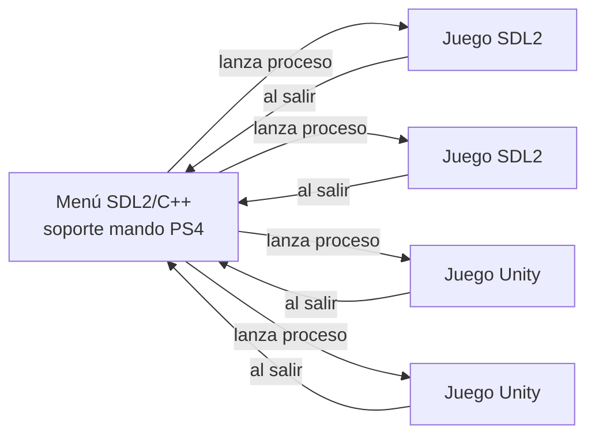

# Mini Juegos — Menú con mandos PS4

Proyecto en equipo (2 personas): un menú que lista y lanza varios minijuegos (3–5).
Cada juego es un **ejecutable independiente** (SDL2/C++ o build de Unity) y el
menú lo lanza como proceso hijo. Al salir del juego vuelves al menú.

## Arquitectura



- **Menú** (`menu/`): SDL2 + SDL2_ttf. Lee `games.registry`, muestra la lista de
  juegos y los lanza como procesos hijo. Navegación con mando PS4 o teclado.
- **Juegos SDL2** (`games/sdl2/`): cada uno es un ejecutable C++ independiente.
- **Juegos Unity** (`games/unity/`): cada uno es un proyecto Unity independiente
  que se compila a un ejecutable.

## Estructura

```
.
├── CMakeLists.txt          # build raiz (menu + juegos SDL2)
├── games.registry          # registro de juegos que muestra el menu
├── menu/                   # el menu (SDL2/C++)
│   └── src/
├── games/
│   ├── sdl2/               # juegos SDL2 (C++)
│   │   ├── template_game/  # plantilla para copiar
│   │   └── ...
│   └── unity/              # proyectos Unity
│       └── ...
├── scripts/                # build.sh / build.bat
└── docs/WORKFLOW.md        # guia de trabajo en equipo
```

## Requisitos

- CMake ≥ 3.16
- Compilador C++17 (g++/clang/MSVC)
- SDL2 y SDL2_ttf (dev)

Instalación en Linux (Debian/Ubuntu):

```bash
sudo apt install cmake g++ libsdl2-dev libsdl2-ttf-dev
```

En Windows: instala SDL2 y SDL2_ttf (paquetes de desarrollo) y usa Visual Studio
o MinGW con CMake.

## Compilar y ejecutar

Linux:

```bash
./scripts/build.sh
./build/bin/menu
```

Windows:

```bat
scripts\build.bat
build\bin\menu.exe
```

> Ejecuta el menú desde la raíz del repositorio (las rutas de `games.registry`
> son relativas a la raíz).

## Controles (menú)

| Acción        | Mando PS4      | Teclado        |
|---------------|----------------|----------------|
| Navegar       | D-pad / palanca| ↑ / ↓         |
| Jugar         | X              | Enter / Espacio|
| Salir         | Círculo        | ESC            |

## Añadir un juego

1. **SDL2**: copia `games/sdl2/template_game/`, renómbrala, edítala y añade
   `add_subdirectory(games/sdl2/<tu_juego>)` al `CMakeLists.txt` raíz.
2. **Unity**: crea el proyecto en `games/unity/<tu_juego>/` y compílalo a
   `build/bin/` (ver `games/unity/README.md`).
3. **Regístralo** en `games.registry` (formato TSV, ver comentarios del archivo).

## Trabajo en equipo

Cada persona desarrolla sus juegos en su propia carpeta sin pisar al otro.
El menú y el registro son compartidos. Lee `docs/WORKFLOW.md` para el flujo de
Git recomendado (ramas, integración y cómo evitar conflictos).